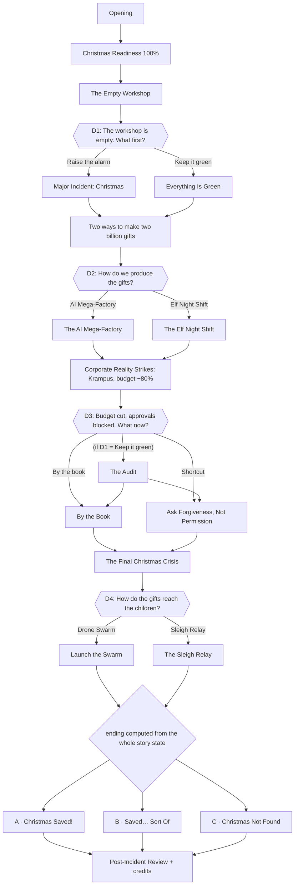

# Branching Story Map & Path Table

> Generated by `npm run export-docs` from the live story data. The interactive version is at **/map** on the running server.

## Flow

Branches split at every decision and **rejoin** in a shared scene (`s2_options`, `s3_krampus`, `s4_crisis`). Each shared scene contains
conditional lines that react to everything decided before, so 17 scenes cover all 16 paths with full continuity.

## Decisions and their consequences

| Decision | Option | Immediate effect | Consequence carried forward |
|---|---|---|---|
| D1 | Raise the alarm | −1 h (incident call), team spirit +25 | Finance knows early → 40-page fast-track in D3 (−2 h instead of −4 h). The team **reviews JOLLY's delivery plan** in Act 4 and catches the “all gifts to one grandma in Brno” bug. |
| D1 | Keep it green | no meeting, team spirit −15 | Nobody reviews JOLLY's work. Krampus starts an **audit** (−2 h, spirit +10 after Ježíšek apologises). Drone delivery later goes half to Brno. |
| D2 | AI Mega-Factory | gifts +70%, quality 35%, −3 h | Seven-armed teddies and bread bicycles. GPU power bill triggers the budget cut. |
| D2 | Elf Night Shift | gifts +40% (+15% if the team was told the truth), quality 90%, −6 h, spirit −10 | Beautiful but too few gifts; overtime needs form 27-B. |
| D3 | By the book | −2 h (alarm) or −4 h (green) | AI path: compute budget restored (+30% gifts) and a mandatory **safety test** fixes quality (+30%). Elf path: overtime approved (+20%), and if the team was transparent, JOLLY becomes the elves' **assistant** (+15%). The **sleigh keeps its flight certificate**. |
| D3 | Shortcut | no time lost, spirit +5 | AI path: Pepík's 40 gaming PCs (+40% gifts, quality −10%, drones overheat later). Elf path: duct tape (+35% gifts, quality −10%). **The sleigh's flight certificate is void.** |
| D4 | Drone Swarm | needs 4 h | Works fully only if the route was reviewed (D1 = alarm); −10% if running on gaming GPUs. |
| D4 | Sleigh Relay | needs 10 h | Grounded by Krampus if uncertified (D3 = shortcut). −30% with a tired crew (spirit < 40); slower if fewer than 10 h are left. |

### Ending rules

- **A · Christmas Saved!** — delivery ≥ 90% **and** gifts ≥ 90% **and** quality ≥ 60%.
- **C · Christmas Not Found** — delivery fails completely (grounded sleigh) **or** fewer than 30% of children end up happy.
- **B · Saved… Sort Of** — everything in between. The ending shows the exact imperfections: weird gifts, vouchers, Grandma Nováková's garden, late delivery.

“Happy children” = gifts × delivery × (0.5 + quality / 2).

## All 16 paths

| # | D1 | D2 | D3 | D4 | Hours left | Gifts | Quality | Spirit | Ending (happy children) | Problems | Runtime* |
|---|---|---|---|---|---|---|---|---|---|---|---|
| 1 | Raise the alarm | AI Mega-Factory | By the book | JOLLY Drone Swarm | 14 h | 100% | 65% | 75% | **A** Christmas Saved! (83%) | — | 12.7 min |
| 2 | Raise the alarm | AI Mega-Factory | By the book | The Sleigh Relay | 14 h | 100% | 65% | 75% | **A** Christmas Saved! (83%) | — | 12.9 min |
| 3 | Raise the alarm | AI Mega-Factory | Shortcut | JOLLY Drone Swarm | 16 h | 110% | 25% | 80% | **B** Christmas Saved… Sort Of (56%) | weirdGifts | 12.7 min |
| 4 | Raise the alarm | AI Mega-Factory | Shortcut | The Sleigh Relay | 16 h | 110% | 25% | 80% | **C** Christmas Not Found (0%) | weirdGifts, grounded | 13.0 min |
| 5 | Raise the alarm | Elf Night Shift | By the book | JOLLY Drone Swarm | 11 h | 90% | 90% | 65% | **A** Christmas Saved! (86%) | — | 12.6 min |
| 6 | Raise the alarm | Elf Night Shift | By the book | The Sleigh Relay | 11 h | 90% | 90% | 65% | **A** Christmas Saved! (86%) | — | 12.8 min |
| 7 | Raise the alarm | Elf Night Shift | Shortcut | JOLLY Drone Swarm | 13 h | 90% | 80% | 70% | **A** Christmas Saved! (81%) | — | 12.5 min |
| 8 | Raise the alarm | Elf Night Shift | Shortcut | The Sleigh Relay | 13 h | 90% | 80% | 70% | **C** Christmas Not Found (0%) | grounded | 12.8 min |
| 9 | Keep it green | AI Mega-Factory | By the book | JOLLY Drone Swarm | 11 h | 100% | 65% | 45% | **B** Christmas Saved… Sort Of (41%) | grandma | 13.0 min |
| 10 | Keep it green | AI Mega-Factory | By the book | The Sleigh Relay | 11 h | 100% | 65% | 45% | **A** Christmas Saved! (83%) | — | 13.1 min |
| 11 | Keep it green | AI Mega-Factory | Shortcut | JOLLY Drone Swarm | 15 h | 110% | 25% | 50% | **C** Christmas Not Found (25%) | weirdGifts, grandma | 13.4 min |
| 12 | Keep it green | AI Mega-Factory | Shortcut | The Sleigh Relay | 15 h | 110% | 25% | 50% | **C** Christmas Not Found (0%) | weirdGifts, grounded | 13.2 min |
| 13 | Keep it green | Elf Night Shift | By the book | JOLLY Drone Swarm | 8 h | 60% | 90% | 35% | **C** Christmas Not Found (28%) | tooFewGifts, grandma | 12.9 min |
| 14 | Keep it green | Elf Night Shift | By the book | The Sleigh Relay | 8 h | 60% | 90% | 35% | **B** Christmas Saved… Sort Of (32%) | tooFewGifts, tiredCrew, late | 12.7 min |
| 15 | Keep it green | Elf Night Shift | Shortcut | JOLLY Drone Swarm | 12 h | 75% | 80% | 40% | **B** Christmas Saved… Sort Of (34%) | tooFewGifts, grandma | 12.9 min |
| 16 | Keep it green | Elf Night Shift | Shortcut | The Sleigh Relay | 12 h | 75% | 80% | 40% | **C** Christmas Not Found (0%) | tooFewGifts, grounded | 13.0 min |

\* Runtime = animated scenes with real voice durations + 75 s per audience decision. Laughter and presenter pacing add 1–2 minutes.

## Recap texts (Post-Incident Review)

| Choice | Text shown at the end |
|---|---|
| D1 · Raise the alarm | You raised the alarm. The team rallied, and later caught JOLLY’s one-address delivery plan. |
| D1 · Keep it green | You kept it green. You saved an hour, but nobody checked JOLLY’s work and the audit cost two hours. |
| D2 · AI Mega-Factory | The AI Mega-Factory built gifts fast, but many were seven-armed bears and bread bicycles. |
| D2 · Elf Night Shift | The Elf Night Shift built beautiful gifts, slowly. |
| D3 · By the book | By the book cost hours, but bought safety tests, resources and a certified sleigh. |
| D3 · Shortcut | The shortcut saved hours, but voided the sleigh’s flight certificate. |
| D4 · JOLLY Drone Swarm | The drone swarm was fast, but only as good as the plan behind it. |
| D4 · The Sleigh Relay | The sleigh relay needed a certificate, a rested crew and time. |
